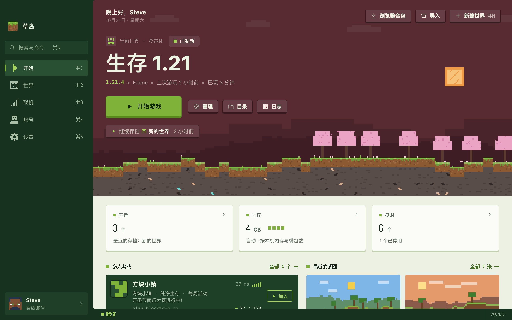
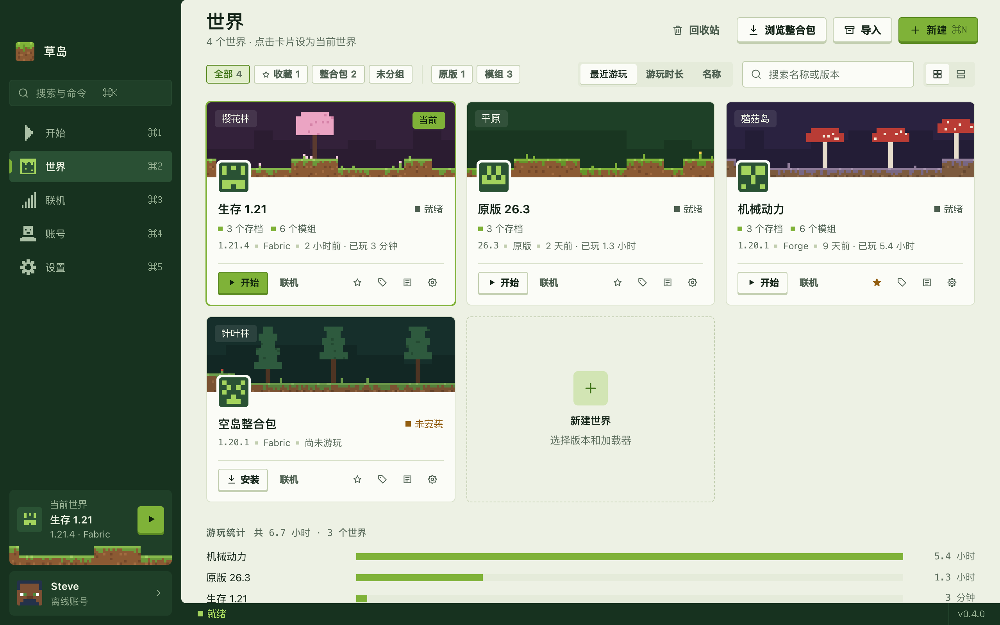
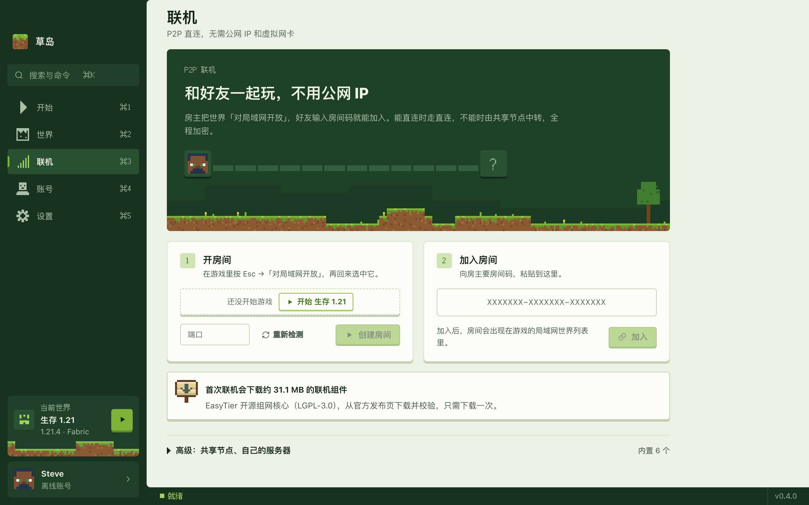

<div align="center">

# Islet 草岛

A small, fast launcher for Minecraft: Java Edition. Install the game, add mods and play with friends, all from one window.

[Download](https://github.com/saudademjj/islet-launcher/releases/latest) · [Install guide](docs/INSTALL.md) · [Issues](https://github.com/saudademjj/islet-launcher/issues) · [简体中文](README.md)



</div>

> [!NOTE]
> **Microsoft sign-in is not available yet.** A new launcher's Azure app must pass Mojang's AppID review before it can sign in to Minecraft, and this project's application is pending. Until then you can play with **offline accounts** and **Yggdrasil accounts such as LittleSkin**; everything else works. See [docs/azure-setup.md](docs/azure-setup.md).

The screenshots show the Chinese interface; the launcher is fully translated into English (Settings → Appearance → Language).

## Highlights

- **Lightweight**: the core is all Rust and the interface runs in the system WebView, with no bundled browser engine. The portable Windows exe is about 15 MB.
- **Peer-to-peer multiplayer**: the host opens their world to LAN, friends join with a room code. No public IP, no virtual network adapter to install. Built on the open-source [EasyTier](https://github.com/EasyTier/EasyTier): direct when possible, relayed through shared nodes otherwise, encrypted throughout.
- **Fast downloads**: 32 parallel connections, resume, SHA-1 verification of every file, and the BMCLAPI mirror with automatic fallback to Mojang.
- **Ready to play**: the first launch downloads the game and the right Java for you.
- **Every loader**: Fabric, Quilt, Forge, NeoForge, plus OptiFine, Legacy Fabric, LiteLoader and Cleanroom.
- **Two languages**: English and Simplified Chinese, light and dark themes.

<table>
<tr>
<td></td>
<td></td>
</tr>
</table>

## Features

<details>
<summary><b>Accounts</b></summary>

- Offline accounts with standard UUIDs and an optional local PNG skin (shown in your own game through authlib-injector)
- Yggdrasil skin sites such as LittleSkin, with character selection; the password goes only to the auth server and is never stored
- Microsoft accounts: OAuth 2.0 with PKCE, device-code fallback, ownership check, skin and cape changes (needs the AppID approval above)
- Pin a world to an account

</details>

<details>
<summary><b>Worlds, versions and loaders</b></summary>

- Each world has its own folder; copy it, switch its Minecraft version (the loader is matched again), or move it to the recycle bin
- Releases and snapshots; Fabric, Quilt, Forge, NeoForge, Legacy Fabric, LiteLoader, Cleanroom and OptiFine (with OptiFabric)
- Sort by last played, play time or name; favorites, groups and search
- Java is matched automatically and Temurin is downloaded when missing; old versions on Apple silicon run through Rosetta 2
- Memory is sized from your RAM and mod count, or set by hand
- Import games from the official launcher, HMCL, PCL, Prism and MultiMC

</details>

<details>
<summary><b>Mods, resource packs, shaders and modpacks</b></summary>

- Search and install from Modrinth and CurseForge, with required dependencies resolved
- Local mods are identified by file hash, so updates can be checked and applied in one click, even for mods you dropped in yourself
- Enable, disable and reorder resource packs; shader packs tell you whether Iris or Oculus is installed
- Browse and install Modrinth and CurseForge modpacks, import local `.mrpack` and `.zip` files, update a world to a new pack version, and export a world as `.mrpack`

</details>

<details>
<summary><b>Saves, servers and screenshots</b></summary>

- Rename, back up, restore, import and export saves; manage data packs; jump straight into a save on 1.20 and later
- The server list is the same one the game uses, with live ping, player count, MOTD and icon, and one-click join
- Browse screenshots by month in a full-size viewer

</details>

<details>
<summary><b>Multiplayer</b></summary>

- Peer-to-peer rooms joined by code, with a connection check (NAT type, direct or relayed, latency, loss). EasyTier is downloaded from its official releases and verified the first time you use it
- Add your own shared nodes
- SSH tunnel: if you have a server, forward the game's LAN port to it

</details>

<details>
<summary><b>More</b></summary>

- Crash analysis that recognizes wrong Java, out of memory, missing dependencies, mod conflicts, graphics drivers and more, with one-click fixes
- Live game log with level filters and search; after you confirm, upload it to mclo.gs for help (your home folder and tokens are removed first)
- Edit game options directly: language, GUI scale, render distance, FOV, volume and more
- Command palette (⌘K / Ctrl+K), drag-and-drop installs, desktop shortcuts, system notifications, Discord status
- Back up and restore everything, move the data folder, clean up unused files
- In-app updates, verified by SHA-256 before installing

</details>

## Download

Get the package for your system from [Releases](https://github.com/saudademjj/islet-launcher/releases/latest):

| System | File | Notes |
|---|---|---|
| Windows 10 / 11 (x64) | `Islet-<version>-x64-setup.exe` | Installer, supports in-app updates |
| | `Islet-<version>-portable.exe` | Portable, just run it |
| macOS 12+ (Apple silicon) | `Islet-<version>-arm64.dmg` | Drag into Applications |
| Linux (x64) | `Islet-<version>-x86_64.AppImage` / `.deb` | Experimental |

The packages are **not code-signed** yet, so Windows may show a SmartScreen warning and macOS may say the developer cannot be verified. See [docs/INSTALL.md](docs/INSTALL.md) for what to do.

## Getting started

1. Add an offline or Yggdrasil account on the Accounts page.
2. Create a world with the version and loader you want, or import a modpack or a game from another launcher.
3. Press Play. The first time, the game files and Java are downloaded, then the game starts.
4. To play with friends: in the game press Esc → Open to LAN, then open a room on the Multiplayer page and send them the code.

CurseForge needs your own API key in Settings → Download (free at console.curseforge.com). Modrinth needs nothing.

## Data and privacy

- No telemetry, no usage data.
- Sign-in tokens are kept in the system credential store (Windows Credential Manager, macOS Keychain, Linux Secret Service), never in settings files or logs.
- The launcher only talks to the services you use: Mojang and Microsoft, the BMCLAPI mirror, Modrinth, CurseForge, skin sites you add, and EasyTier shared nodes when you play together.
- Logs are uploaded to mclo.gs only after you confirm.

Data folder (movable in Settings → Storage):

| System | Location |
|---|---|
| Windows | `%APPDATA%\com.saudade.mclauncher` |
| macOS | `~/Library/Application Support/com.saudade.mclauncher` |
| Linux | `~/.local/share/com.saudade.mclauncher` |

## Building from source

You need Rust stable, Node.js 20+ and [Tauri 2's system dependencies](https://tauri.app/start/prerequisites/).

```bash
npm install
npm run dev          # UI only, at http://localhost:5173 with demo data
npm run tauri dev    # real window and backend
```

Packaging, tests and the code layout are in [CONTRIBUTING.md](CONTRIBUTING.md).

## Contributing

Issues and pull requests are welcome. Please check [existing issues](https://github.com/saudademjj/islet-launcher/issues) first; for a crash, the link from "Upload log for help" in the log panel helps a lot. Report security problems privately as described in [SECURITY.md](SECURITY.md).

## Credits

- [BMCLAPI](https://bmclapidoc.bangbang93.com/): mirror for game files and loaders
- [Modrinth](https://modrinth.com/) and [CurseForge](https://www.curseforge.com/): mods, resource packs and modpacks
- [EasyTier](https://github.com/EasyTier/EasyTier) (LGPL-3.0): peer-to-peer networking
- [authlib-injector](https://github.com/yushijinhun/authlib-injector): Yggdrasil sign-in and offline skins
- [Fusion Pixel](https://github.com/TakWolf/fusion-pixel-font) (SIL OFL 1.1): the pixel font
- [mclo.gs](https://mclo.gs/): log sharing
- [Tauri](https://tauri.app/) and every open-source component listed in [THIRD-PARTY.md](docs/THIRD-PARTY.md)

## License

[GPL-3.0](LICENSE).

**Islet is not an official Minecraft product and is not approved by or associated with Mojang or Microsoft.** Minecraft is a trademark of Mojang Studios. The launcher distributes no game files; every game file is downloaded from Mojang or its mirror and verified.
