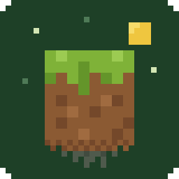
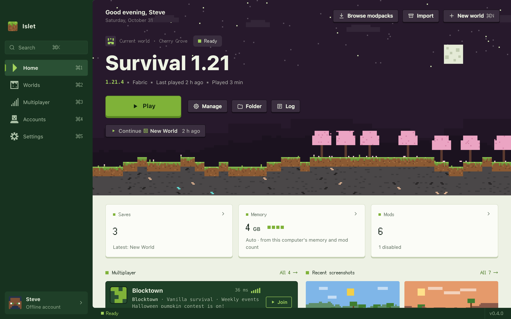
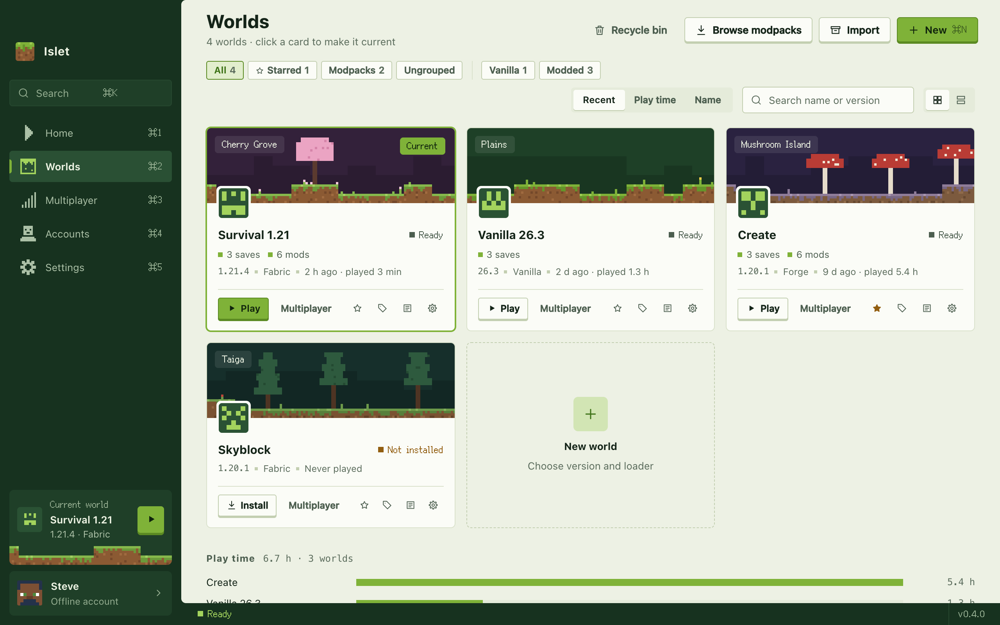
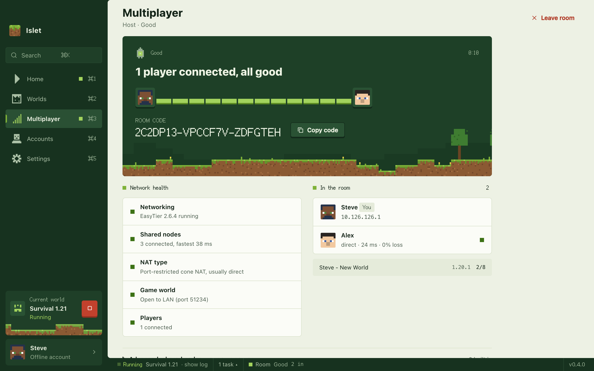
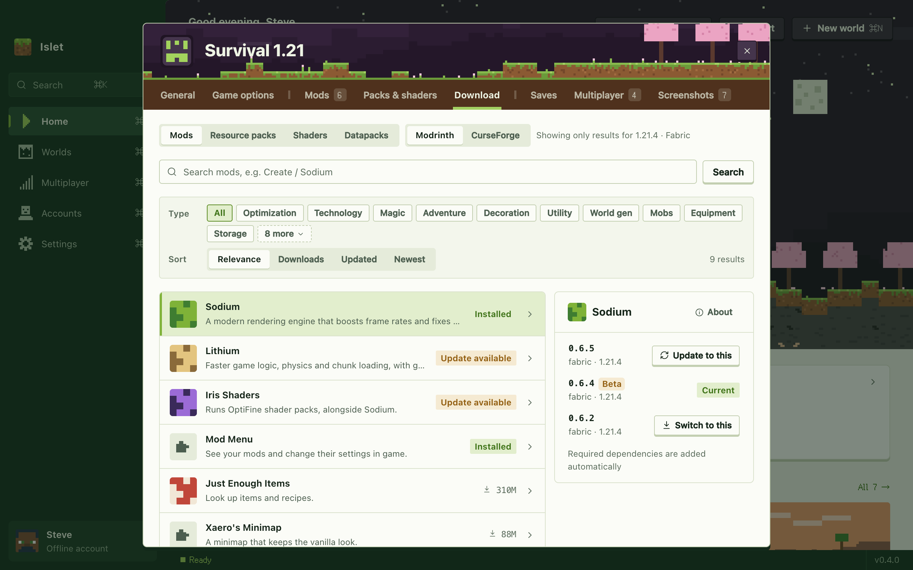
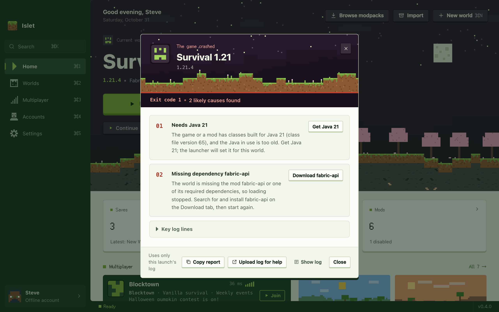

<div align="center">



# Islet

**A tiny, fast launcher for Minecraft: Java Edition.**<br>
Every world is its own little island. Friends are one room code away.

[](https://github.com/saudademjj/islet-launcher/releases/latest)
[](#download)
[](LICENSE)

**[Download](https://github.com/saudademjj/islet-launcher/releases/latest)** · [Install guide](docs/INSTALL.en.md) · [简体中文](README.zh-CN.md)

<br>

<picture>
  <source media="(prefers-color-scheme: dark)" srcset="docs/images/en/home-dark.png">
  
</picture>

</div>

<br>

<table>
<tr>
<td width="33%" valign="top">
<br>
<b>Tiny</b><br>
A Rust core on the WebView your system already has. The Windows installer is 5&nbsp;MB.
</td>
<td width="33%" valign="top">
<br>
<b>Play together</b><br>
Open your world to LAN and share a room code. Friends join over an encrypted peer-to-peer link, no port forwarding, and rooms work with HMCL and PCL CE too.
</td>
<td width="33%" valign="top">
<br>
<b>Mods without the hunt</b><br>
Search Modrinth and CurseForge. Dependencies come along, and updating everything takes one click.
</td>
</tr>
<tr>
<td valign="top">
<br>
<b>Crashes, explained</b><br>
Islet reads the crash log, tells you what went wrong in plain words, and fixes the common causes in one click.
</td>
<td valign="top">
<br>
<b>Just press Play</b><br>
The game and the right Java download on first launch: fast, resumable, every file verified.
</td>
<td valign="top">
<br>
<b>One world, one island</b><br>
Each world keeps its own version, loader, mods and saves, and gets a pixel landscape of its own.
</td>
</tr>
</table>

## Screenshots

<table>
<tr>
<td width="50%" valign="top">

<p align="center"><b>Worlds</b> · every world on its own card</p>
</td>
<td width="50%" valign="top">

<p align="center"><b>Multiplayer</b> · share a code, see who's in</p>
</td>
</tr>
<tr>
<td valign="top">

<p align="center"><b>Mods</b> · only what fits your version and loader</p>
</td>
<td valign="top">

<p align="center"><b>Crash help</b> · what went wrong, and how to fix it</p>
</td>
</tr>
</table>

## Download

| System | Package |
| :-- | :-- |
| **Windows** 10 / 11 · x64 | `Islet-<version>-x64-setup.exe` installer<br>`Islet-<version>-x64-portable.exe` portable |
| **Windows** 11 · ARM | `Islet-<version>-arm64-setup.exe` · `Islet-<version>-arm64-portable.exe` |
| **macOS** 12+ · Apple silicon | `Islet-<version>-arm64.dmg` |
| **macOS** 12+ · Intel | `Islet-<version>-x86_64.dmg` |
| **Linux** x64 · experimental | `Islet-<version>-x86_64.AppImage` · `Islet-<version>-amd64.deb` |
| **Linux** ARM64 · experimental | `Islet-<version>-aarch64.AppImage` · `Islet-<version>-arm64.deb` |

Get them from the **[latest release](https://github.com/saudademjj/islet-launcher/releases/latest)**. The packages aren't code-signed yet, so Windows and macOS will check with you before the first launch; the [install guide](docs/INSTALL.en.md) shows what to click.

> [!NOTE]
> Microsoft sign-in switches on once Mojang approves Islet's app ID, which is under review. Until then, play with an offline or authlib-injector account.

## Everything else

- **Loaders**: Fabric, Quilt, Forge, NeoForge, OptiFine, Legacy Fabric, LiteLoader, Cleanroom
- **Modpacks and servers**: browse Modrinth and CurseForge, import `.mrpack` and `.zip`; export a world as a modpack, or as a server ready to run (client-only mods left out, your save and inventory brought along)
- **From singleplayer to your own server**: deploy a world to a Linux cloud server over SSH in one step (Java installed for you), then start, stop, back up, use the console and sync mods from the launcher; friends get a pack with the address filled in, and missing mods are fetched before they join
- **Packs and shaders**: reorder resource packs; Islet tells you when a shader needs Iris or Oculus
- **Saves and maps**: automatic backups after you play, plus manual backup, restore, import and export; maps from CurseForge; jump straight into a save on 1.20+
- **Mod configs**: edit the files in `config/` inside the launcher, with the previous version kept on every save
- **Servers**: the game's own list, with live ping and one-click join
- **Accounts**: offline with local skins, authlib-injector servers such as LittleSkin, 统一通行证 (Nide8), and Microsoft
- **Moving in**: bring worlds over from the official launcher, HMCL, PCL, Prism and MultiMC
- **Shortcuts**: ⌘K / Ctrl+K command palette, drag-and-drop installs, desktop shortcuts, Discord status
- **Private**: no telemetry, and sign-in tokens stay in your system keychain
- English and Simplified Chinese, light and dark

CurseForge search needs a free API key in Settings → Download.

## Build it yourself

You need Rust (stable), Node.js 20+ and the [Tauri prerequisites](https://tauri.app/start/prerequisites/).

```bash
npm install
npm run tauri dev   # the app with its real backend
npm run dev         # just the interface, with demo data, at http://localhost:5173
```

Bug reports and pull requests are welcome; see [CONTRIBUTING.md](CONTRIBUTING.md). Please report security issues privately, as [SECURITY.md](SECURITY.md) describes.

## Thanks

[BMCLAPI](https://bmclapidoc.bangbang93.com/) for the download mirror · [Modrinth](https://modrinth.com/) and [CurseForge](https://www.curseforge.com/) for mods and modpacks · [EasyTier](https://github.com/EasyTier/EasyTier) for peer-to-peer rooms · [authlib-injector](https://github.com/yushijinhun/authlib-injector) for third-party sign-in · [Fusion Pixel](https://github.com/TakWolf/fusion-pixel-font) for the pixel font · [mclo.gs](https://mclo.gs/) for log sharing · [Tauri](https://tauri.app/), and every project in [THIRD-PARTY.md](docs/THIRD-PARTY.md)

## License

[GPL-3.0](LICENSE). Islet is not an official Minecraft product, and is not approved by or associated with Mojang or Microsoft.
