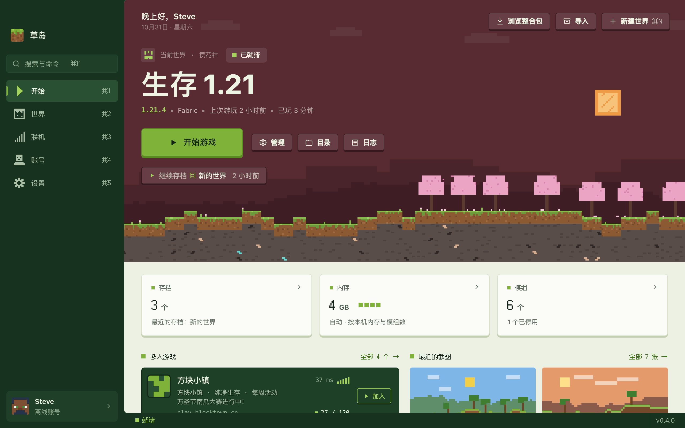
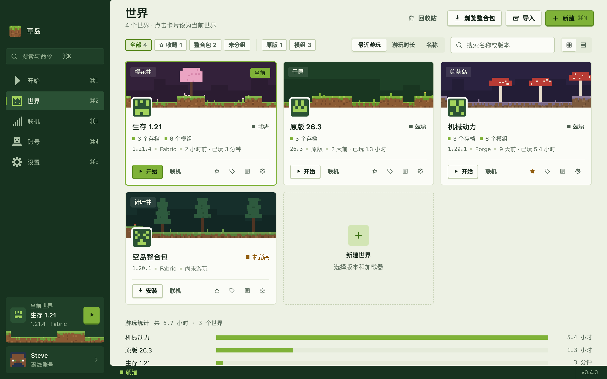

<div align="center">

# 草岛 Islet

一个小而快的 Minecraft Java 版启动器：装游戏、装模组、和朋友联机，都在一个窗口里。

[下载](https://github.com/saudademjj/islet-launcher/releases/latest) · [安装说明](docs/INSTALL.md) · [问题反馈](https://github.com/saudademjj/islet-launcher/issues) · [English](README.en.md)



</div>

> [!NOTE]
> **微软正版登录暂不可用。** 新启动器的 Azure 应用需要先通过 Mojang 的 AppID 审核才能登录 Minecraft，本项目正在申请中。在此之前可以使用**离线账号**和 **LittleSkin 等外置登录**，其他功能不受影响。详见 [docs/azure-setup.md](docs/azure-setup.md)。

## 特点

- **轻量**：核心全部是 Rust，界面跑在系统自带的 WebView 里，不打包浏览器内核；Windows 免安装版约 15 MB。
- **P2P 联机**：房主在游戏里「对局域网开放」，好友输入房间码就能加入，不需要公网 IP、不用装虚拟网卡。基于开源的 [EasyTier](https://github.com/EasyTier/EasyTier)，能直连时直连，不能时经共享节点中转，全程加密。
- **国内友好**：默认走 BMCLAPI 镜像，失败自动回退官方源；32 并发、断点续传、逐个校验 SHA-1。
- **开箱即用**：第一次启动会自动下载游戏和所需的 Java，新世界默认简体中文。
- **全加载器**：Fabric、Quilt、Forge、NeoForge，以及 OptiFine、Legacy Fabric、LiteLoader、Cleanroom。
- **双语界面**：简体中文 / English，浅色 / 深色主题。

<table>
<tr>
<td></td>
<td></td>
</tr>
</table>

## 功能

<details>
<summary><b>账号</b></summary>

- 离线账号：按 Minecraft 标准算法生成 UUID，可以用本地 PNG 皮肤（经 authlib-injector 在本机游戏中显示）
- 外置登录：LittleSkin 等 Yggdrasil 皮肤站，多角色可选，密码只发给认证服务器、不保存
- 微软正版登录：OAuth 2.0 + PKCE，设备代码流兜底，校验正版拥有；可换皮肤和披风（需要通过 AppID 审核，见上方说明）
- 每个世界可以固定用某个账号进入

</details>

<details>
<summary><b>世界、版本与加载器</b></summary>

- 每个世界独立的目录，可以复制、换 Minecraft 版本（加载器自动重新匹配）、移到回收站
- 正式版与快照，Fabric / Quilt / Forge / NeoForge / Legacy Fabric / LiteLoader / Cleanroom，OptiFine（含 OptiFabric）
- 按最近游玩、游玩时长或名称排序，记录每个世界的游玩时长；收藏、分组和搜索
- Java 自动匹配，缺少时自动下载 Temurin；Apple Silicon 上的老版本自动用 Rosetta 2 运行
- 内存按本机物理内存和模组数量自动分配，也可以手动设置
- 导入官方启动器、HMCL、PCL、Prism、MultiMC 里已有的游戏

</details>

<details>
<summary><b>模组、资源包、光影与整合包</b></summary>

- 从 Modrinth 和 CurseForge 搜索安装（支持「机械动力」这样的中文名），自动解析必需前置
- 按文件哈希识别本地模组，检查更新并一键全部更新；手动放进去的模组也能识别
- 资源包在启动器里启用、停用和排序；光影会提示是否已装 Iris / Oculus
- 浏览并安装 Modrinth / CurseForge 整合包，导入本地 `.mrpack` / `.zip`，用新版整合包更新世界，把世界导出为 `.mrpack`

</details>

<details>
<summary><b>存档、服务器与截图</b></summary>

- 存档列表：改名、备份 / 恢复、导入导出 `.zip`、管理数据包；1.20 及以上可以直接进入某个存档
- 服务器列表与游戏内是同一份，实时显示延迟、在线人数、MOTD 和图标，一键进服
- 按月浏览游戏截图，大图查看

</details>

<details>
<summary><b>联机</b></summary>

- P2P 房间：房间码加入，连接状态体检（NAT 类型、直连 / 中转、延迟、丢包）；联机组件 EasyTier 首次使用时从官方发布页下载并校验
- 也可以填自己的共享节点
- SSH 隧道：有自己服务器的玩家可以把游戏的局域网端口反向转发到公网

</details>

<details>
<summary><b>其他</b></summary>

- 游戏崩溃时识别 Java 版本不符、内存不足、缺少前置、模组冲突、显卡驱动等原因，并给出一键修复
- 实时日志，按级别筛选、搜索；确认后可以把日志上传到 mclo.gs 求助（会先隐去用户目录和令牌）
- 直接修改游戏选项：语言、界面缩放、渲染距离、视场角、音量等
- ⌘K / Ctrl+K 命令面板、拖入文件安装、桌面快捷方式、系统通知、Discord 状态
- 备份与恢复全部数据、迁移存储目录、清理不再使用的文件
- 启动器内检查更新，下载后校验 SHA-256 再安装

</details>

## 下载与安装

到 [Releases](https://github.com/saudademjj/islet-launcher/releases/latest) 下载对应系统的安装包：

| 系统 | 文件 | 说明 |
|---|---|---|
| Windows 10 / 11（x64） | `Islet-<版本>-x64-setup.exe` | 安装版，支持启动器内更新 |
| | `Islet-<版本>-portable.exe` | 免安装版，双击即用 |
| macOS 12+（Apple 芯片） | `Islet-<版本>-arm64.dmg` | 拖进「应用程序」 |
| Linux（x64） | `Islet-<版本>-x86_64.AppImage` / `.deb` | 实验性支持 |

安装包目前**没有代码签名**，Windows 可能弹出 SmartScreen 提示、macOS 可能提示无法验证开发者。处理方法和各系统的详细步骤见 [docs/INSTALL.md](docs/INSTALL.md)。

## 快速开始

1. 在「账号」页添加离线账号或外置登录账号。
2. 「新建世界」选择版本和加载器，或者「导入」整合包、其他启动器里的游戏。
3. 点「开始」：第一次会自动下载游戏文件和 Java，完成后直接进入游戏。
4. 想和朋友一起玩：在游戏里按 Esc →「对局域网开放」，然后到「联机」页「开房间」，把房间码发给朋友。

CurseForge 需要在「设置 → 下载」填写自己的 API Key（在 console.curseforge.com 免费申请）；Modrinth 不需要。

## 数据与隐私

- 不收集任何使用数据，没有遥测。
- 账号令牌保存在系统凭据库（Windows 凭据管理器 / macOS 钥匙串 / Linux Secret Service），不会写进配置文件或日志。
- 启动器只连接你用到的服务：Mojang / 微软、BMCLAPI 镜像、Modrinth、CurseForge、你添加的皮肤站，联机时连接 EasyTier 共享节点。
- 日志只有在你确认后才会上传到 mclo.gs。

数据目录（可以在「设置 → 存储」迁移）：

| 系统 | 位置 |
|---|---|
| Windows | `%APPDATA%\com.saudade.mclauncher` |
| macOS | `~/Library/Application Support/com.saudade.mclauncher` |
| Linux | `~/.local/share/com.saudade.mclauncher` |

## 从源码构建

需要 Rust stable、Node.js 20+，以及 [Tauri 2 的系统依赖](https://tauri.app/start/prerequisites/)。

```bash
npm install
npm run dev          # 只看界面：浏览器打开 http://localhost:5173，使用内置演示数据
npm run tauri dev    # 真实窗口 + 真实后端
```

打包、测试和代码结构见 [CONTRIBUTING.md](CONTRIBUTING.md)。

## 参与贡献

欢迎提交 Issue 和 Pull Request。报告问题前请先看看 [已有的 Issue](https://github.com/saudademjj/islet-launcher/issues)，游戏崩溃时附上日志面板里「上传日志求助」得到的链接会很有帮助。安全问题请按 [SECURITY.md](SECURITY.md) 私下报告。

## 致谢

- [BMCLAPI](https://bmclapidoc.bangbang93.com/)：游戏文件与加载器镜像
- [Modrinth](https://modrinth.com/) 与 [CurseForge](https://www.curseforge.com/)：模组、资源包和整合包
- [EasyTier](https://github.com/EasyTier/EasyTier)（LGPL-3.0）：P2P 联机组网
- [authlib-injector](https://github.com/yushijinhun/authlib-injector)：外置登录与离线皮肤
- [Fusion Pixel](https://github.com/TakWolf/fusion-pixel-font)（SIL OFL 1.1）：界面像素字体
- [mclo.gs](https://mclo.gs/)：日志分享
- [Tauri](https://tauri.app/)，以及 [THIRD-PARTY.md](docs/THIRD-PARTY.md) 中列出的所有开源组件

## 许可

本项目以 [GPL-3.0](LICENSE) 开源。

**草岛不是 Minecraft 官方产品，未经 Mojang 或 Microsoft 批准，也与其无关。** Minecraft 是 Mojang Studios 的商标。启动器不分发任何游戏文件，所有游戏文件都从 Mojang 官方或其镜像下载并校验。
