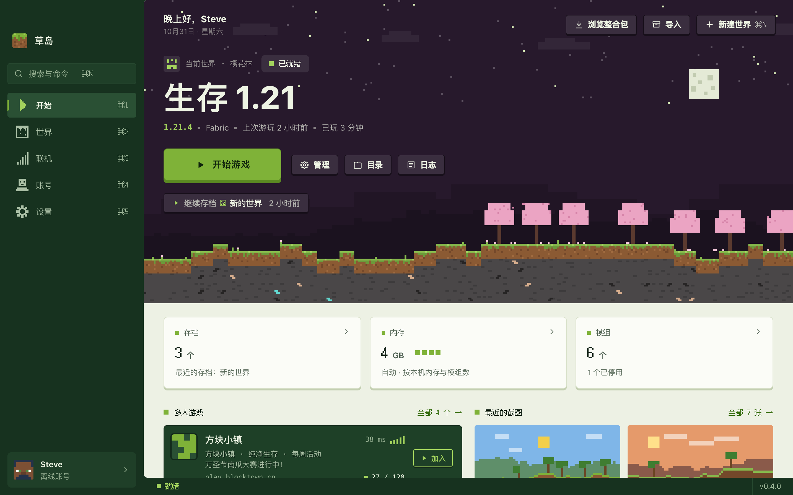
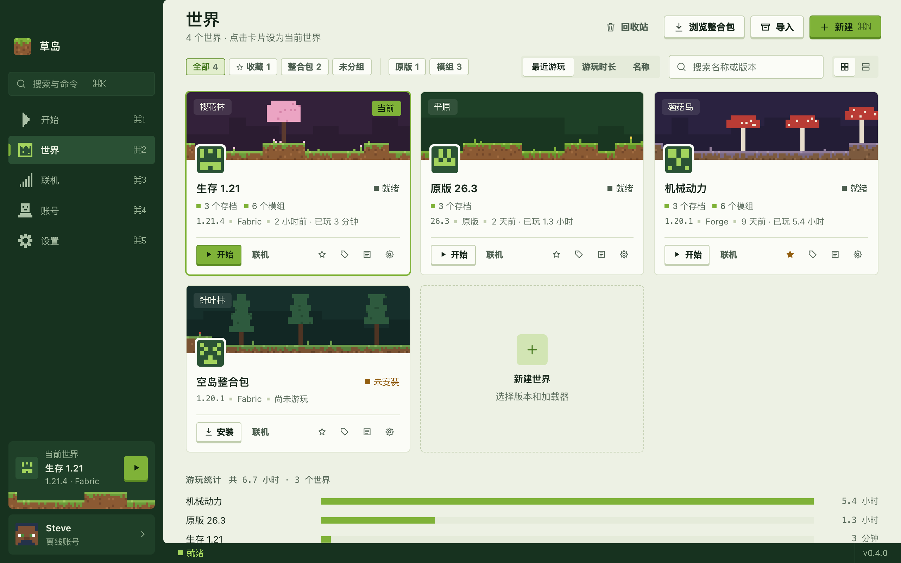
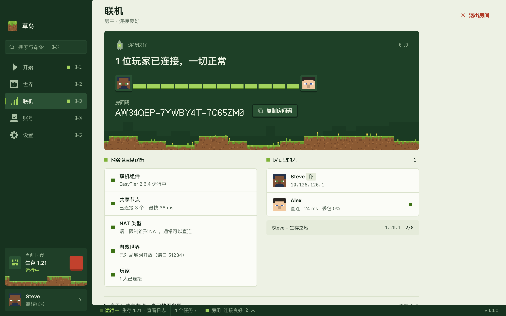
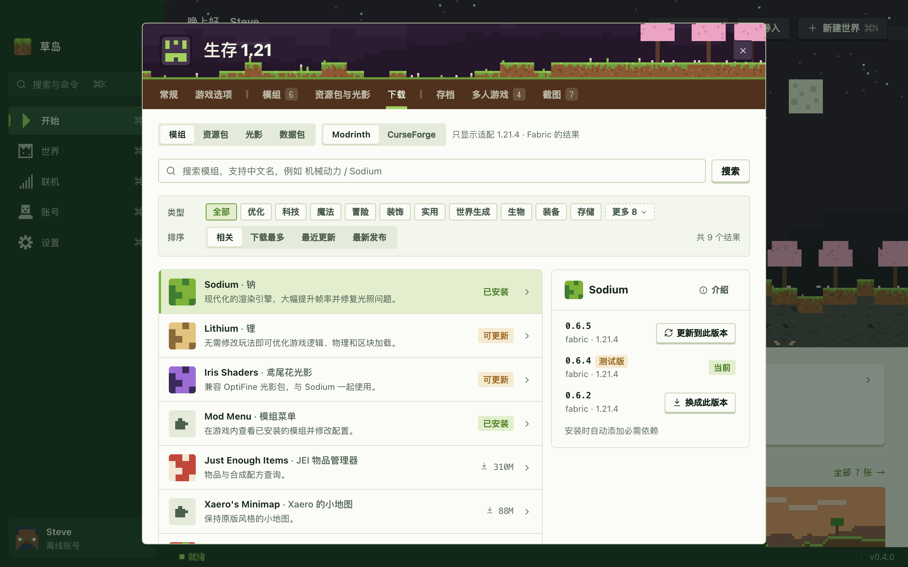
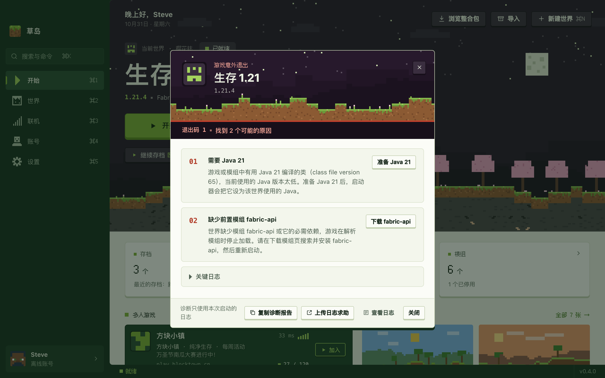

<div align="center">


# 草岛 Islet

**小而快的 Minecraft Java 版启动器。**<br>
每个世界都是一座小岛；想和朋友一起玩，发个房间码就行。

[](https://github.com/saudademjj/islet-launcher/releases/latest)
[](#下载)
[](LICENSE)

**[下载](https://github.com/saudademjj/islet-launcher/releases/latest)** · [安装说明](docs/INSTALL.md) · [English](README.md)

<br>

<picture>
  <source media="(prefers-color-scheme: dark)" srcset="docs/images/zh/home-dark.png">
  
</picture>

</div>

<br>

<table>
<tr>
<td width="33%" valign="top">
<br>
<b>小巧</b><br>
Rust 内核，界面用系统自带的 WebView。Windows 安装包只有 5&nbsp;MB。
</td>
<td width="33%" valign="top">
<br>
<b>一码联机</b><br>
在游戏里「对局域网开放」，把房间码发给好友就能一起玩。点对点加密，不用公网 IP，也不用端口转发；和 HMCL、PCL CE 的联机房间互通。
</td>
<td width="33%" valign="top">
<br>
<b>模组随手装</b><br>
Modrinth、CurseForge 一起搜，中文名也认得。前置自动带上，全部更新只要点一下。
</td>
</tr>
<tr>
<td valign="top">
<br>
<b>崩溃看得懂</b><br>
读完崩溃日志，用大白话告诉你哪里出了问题；常见的毛病点一下就能修好。
</td>
<td valign="top">
<br>
<b>点开始就能玩</b><br>
游戏和对应的 Java 首次启动自动下载。默认走 BMCLAPI 镜像，不通时自动换回官方源。
</td>
<td valign="top">
<br>
<b>一个世界，一座岛</b><br>
版本、加载器、模组、存档各管各的，互不打扰；每个世界还有一片自己的像素风景。
</td>
</tr>
</table>

## 截图

<table>
<tr>
<td width="50%" valign="top">

<p align="center"><b>世界</b> · 每个世界一张卡片</p>
</td>
<td width="50%" valign="top">

<p align="center"><b>联机</b> · 发个房间码，谁进来了一目了然</p>
</td>
</tr>
<tr>
<td valign="top">

<p align="center"><b>模组</b> · 只列出适配当前版本和加载器的</p>
</td>
<td valign="top">

<p align="center"><b>崩溃诊断</b> · 出了什么问题，该怎么修</p>
</td>
</tr>
</table>

## 下载

| 系统 | 安装包 |
| :-- | :-- |
| **Windows** 10 / 11 · x64 | `Islet-<版本>-x64-setup.exe` 安装版<br>`Islet-<版本>-x64-portable.exe` 免安装版 |
| **Windows** 11 · ARM | `Islet-<版本>-arm64-setup.exe` · `Islet-<版本>-arm64-portable.exe` |
| **macOS** 12+ · Apple 芯片 | `Islet-<版本>-arm64.dmg` |
| **macOS** 12+ · Intel | `Islet-<版本>-x86_64.dmg` |
| **Linux** x64 · 实验性 | `Islet-<版本>-x86_64.AppImage` · `Islet-<版本>-amd64.deb` |
| **Linux** ARM64 · 实验性 | `Islet-<版本>-aarch64.AppImage` · `Islet-<版本>-arm64.deb` |

到[最新版本](https://github.com/saudademjj/islet-launcher/releases/latest)下载。安装包暂时没有代码签名，Windows 和 macOS 首次打开时会弹出安全提示，照着[安装说明](docs/INSTALL.md)操作即可。

> [!NOTE]
> 微软正版登录要等 Mojang 审核通过草岛的 AppID，目前正在审核，通过后不用更新就能用。在此之前，请先用离线账号或外置登录。

## 还有这些

- **加载器**：Fabric、Quilt、Forge、NeoForge、OptiFine、Legacy Fabric、LiteLoader、Cleanroom
- **整合包与开服**：浏览 Modrinth 和 CurseForge，导入 `.mrpack` / `.zip`；把自己的世界导出成整合包，或一键生成能直接运行的服务端（自动去掉只在客户端运行的模组，单人存档和背包一起带进去）
- **从单机到开服一条龙**：通过 SSH 一键部署到自己的 Linux 云服务器（自动装 Java），在启动器里开关、备份、看控制台、同步模组；朋友拿到的整合包已填好服务器地址，进服前缺的模组自动补齐
- **资源包与光影**：调整资源包顺序；光影缺 Iris / Oculus 时会提醒
- **存档与地图**：玩完自动备份，也能手动备份、恢复、导入导出；从 CurseForge 下载地图；1.20 以上可以直接进入某个存档
- **模组配置**：在启动器里直接改 `config/` 里的配置文件，每次保存前自动留一份旧版
- **服务器**：和游戏里同一份列表，实时显示延迟，一键进服
- **账号**：离线账号（可用本地皮肤）、LittleSkin 等外置登录、统一通行证、微软正版
- **搬家**：把官方启动器、HMCL、PCL、Prism、MultiMC 里的游戏直接导进来
- **顺手**：⌘K / Ctrl+K 命令面板、拖入文件安装、桌面快捷方式、Discord 状态
- **隐私**：没有任何遥测，登录令牌只存在系统钥匙串里
- 简体中文 / English，浅色 / 深色

CurseForge 搜索需要在「设置 → 下载」填一个免费的 API Key。

## 自己构建

需要 Rust stable、Node.js 20+，以及 [Tauri 的系统依赖](https://tauri.app/start/prerequisites/)。

```bash
npm install
npm run tauri dev   # 完整的应用，真实后端
npm run dev         # 只看界面：演示数据，浏览器打开 http://localhost:5173
```

欢迎提 Issue 和 Pull Request，详见 [CONTRIBUTING.md](CONTRIBUTING.md)；安全问题请按 [SECURITY.md](SECURITY.md) 私下报告。

## 致谢

[BMCLAPI](https://bmclapidoc.bangbang93.com/) 提供下载镜像 · [Modrinth](https://modrinth.com/) 与 [CurseForge](https://www.curseforge.com/) 提供模组和整合包 · [EasyTier](https://github.com/EasyTier/EasyTier) 支撑 P2P 联机 · [authlib-injector](https://github.com/yushijinhun/authlib-injector) 支持外置登录 · [Fusion Pixel](https://github.com/TakWolf/fusion-pixel-font) 像素字体 · [mclo.gs](https://mclo.gs/) 日志分享 · [Tauri](https://tauri.app/)，以及 [THIRD-PARTY.md](docs/THIRD-PARTY.md) 里的所有开源项目

## 许可

[GPL-3.0](LICENSE)。草岛不是 Minecraft 官方产品，未经 Mojang 或 Microsoft 批准，也与其无关。
